## 👋 关于我

- 🎮 折腾**游戏 AI 与模组**：Terraria / tModLoader、Unity IL2CPP
- 📱 给自己写 **Android 小工具**：Kotlin / Jetpack Compose
- 🧰 顺手的语言：C# · Kotlin · Python · PowerShell

## 🚀 在做的项目

<table>
<tr>
<td width="50%" valign="top">

<h3 align="center">TerraPilot</h3>

面向 Terraria / tModLoader 的通用 Boss 战斗 AI。读取 NPC 与弹幕，用短时轨迹预测挑选路线，再转换成原生的移动、跳跃、飞行和武器输入，无需模型 API 或联网推理。

</td>
<td width="50%" valign="top">

<h3 align="center">一叶签 LeafSign</h3>

原生 Android 每日签到工具。网易云音乐、百度贴吧、森空岛、哔哩哔哩，一个按钮完成每日任务；完全本地运行，没有自建服务器，凭证只发往官方域名。

</td>
</tr>
</table>

两个项目目前都是私有仓库，暂不公开源码。

## 🛠️ 技术栈

## 📊 GitHub 动态

<picture>
  <source media="(prefers-color-scheme: dark)" srcset="https://streak-stats.demolab.com/?user=yejiu0210&theme=tokyonight&hide_border=true&background=00000000&ring=34D399&fire=F59E0B&currStreakLabel=34D399">
  
</picture>

<picture>
  <source media="(prefers-color-scheme: dark)" srcset="https://raw.githubusercontent.com/yejiu0210/yejiu0210/output/snake-dark.svg">
  
</picture>

